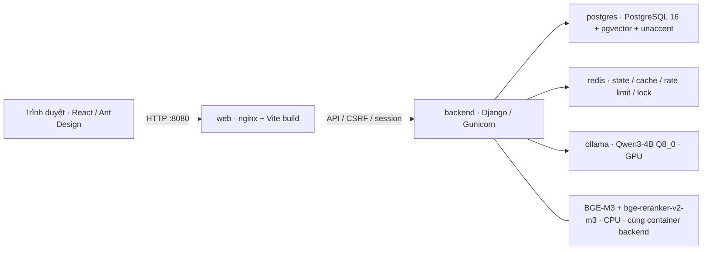
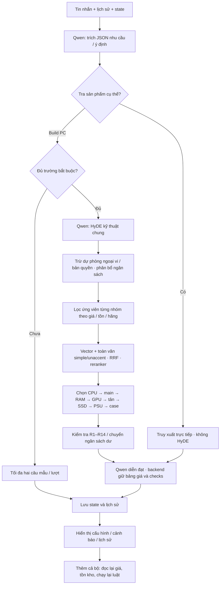

# Kiến trúc TechZone và chatbot tư vấn PC

Kiến trúc đối chiếu với `De-cuong-chatbot-tu-van-PC-ver2.docx`. Frontend React/Vite và backend Django hiện có được giữ lại; pipeline mới nằm trong `src/backend/core/advisor/`.

## Triển khai theo đề cương

`docker-compose.advisor.yml` định nghĩa năm service. Chỉ nginx mở cổng cho trình duyệt. Embedding và reranker chạy CPU trong backend; Ollama sử dụng GPU NVIDIA.



Các volume riêng lưu database, Redis AOF, trọng số Ollama, trọng số Hugging Face và static files. Compose dùng volume mới, không tự chuyển dữ liệu từ volume `techzone_data` của container cũ. Cần sao lưu và chuyển dữ liệu có kiểm soát khi đổi môi trường.

`Dockerfile` ở thư mục gốc vẫn là cách chạy ứng dụng trong một container. Nó được bổ sung extension pgvector để chạy migration mới; môi trường chatbot đầy đủ dùng Compose vì image gốc không cài embedding/reranker hay Redis. Hướng dẫn chạy: [Chatbot.md](Chatbot.md).

## Luồng tư vấn



Qwen dùng endpoint tương thích OpenAI `/v1/chat/completions`, JSON schema cho trích nhu cầu, `reasoning_effort=none` và chỉ dẫn `/no_think`. Context 8192 được cấu hình bằng Modelfile. HyDE chỉ là đầu vào truy xuất, không được dùng làm thông số hoặc giá sản phẩm.

Bộ chọn linh kiện là thuật toán tham lam: mỗi bước có hạn mức theo mục đích, cộng tiền dư bước trước; ưu tiên thứ hạng truy xuất rồi giá cao nhất trong hạn mức. Ứng viên lỗi hoặc chưa xác minh luật mức error bị loại. Không có backtracking và không tuyên bố tối ưu toàn cục. Phương án thiếu linh kiện vẫn được trình bày để khách điều chỉnh; nút thêm cả bộ bị khóa.

## Các mô-đun

| File / mô-đun | Trách nhiệm |
|---|---|
| `core/chat_views.py` | Auth, CSRF, rate limit, chống gửi đồng thời, persistence |
| `advisor/llm.py` | Gọi Qwen cục bộ, kiểm tra lỗi và phản hồi bị cắt |
| `advisor/requirements.py` | Schema nhu cầu, cập nhật trường rõ ràng, câu hỏi mẫu, mặc định sau hai lần hỏi |
| `advisor/catalog.py` | Chuyển catalog cũ sang khóa chuẩn, xác minh giá/tồn, fingerprint |
| `advisor/retrieval.py` | BGE-M3 CPU, trung bình vector gốc/HyDE, toàn văn, RRF, reranker |
| `advisor/assembly.py` | Phân bổ ngân sách, chọn tuần tự và giữ sản phẩm được cố định |
| `advisor/rules.py` | Luật R1–R14, phân biệt pass / fail / unknown và error / warning |
| `advisor/pipeline.py` | Điều phối tra cứu, hỏi bổ sung và tư vấn cấu hình |
| `advisor/cart.py` | Đọc lại DB khi thêm cả bộ hoặc sửa số lượng; nhân số thanh/dung lượng RAM theo số lượng |
| `core/advisor_views.py` | API lịch sử và kiểm tra cấu hình |
| `core/models.py` | Product vector và các bảng ChatSession / ChatMessage |
| `index_advisor_catalog` | Nhúng lại sản phẩm có nội dung/model embedding thay đổi |
| `import_advisor_catalog` | Nhập catalog có specs chuẩn, giữ các sản phẩm khác |
| `evaluate_advisor` | Chạy hội thoại gán nhãn, xuất trace và chỉ số nghiệp vụ |

API tiếp tục dùng Django JsonResponse và session/CSRF hiện có; chưa chuyển toàn bộ dự án sang Django REST Framework. Không cần framework REST mới để thực hiện pipeline.

## Lưu trữ

Product hiện có vẫn là nguồn duy nhất: `external_id` là SKU, `payload` JSONB chứa tên/hãng/giá/tồn/`specs`/mô tả và thuộc tính cũ. Không tạo bảng sản phẩm thứ hai. Vector 1024 chiều và fingerprint nằm ngay trong Product.

Migration `0015_advisor_architecture` thêm pgvector/unaccent; vector HNSW; tsvector sinh tự động, GIN toàn văn và specs; cột giá/tồn số sinh từ payload và B-tree theo danh mục/giá/tồn. SQL truy xuất chỉ nhận ID ứng viên đã lọc theo nhóm và ngân sách, đồng thời kiểm tra lại giá/tồn hiện tại. Fingerprint loại bỏ vector cũ khi tên, hãng, danh mục, specs, mô tả hoặc model embedding thay đổi. Chạy lệnh index sau cập nhật nội dung; thay giá/tồn không cần nhúng lại.

Phiếu nhu cầu lưu trong Redis theo ChatSession, có bản bền vững trong PostgreSQL để khôi phục khi cache bị xóa. ChatMessage lưu nội dung, kết quả cấu hình, trace truy xuất, độ trễ. Quyền đọc/khôi phục lịch sử luôn lọc theo người dùng đăng nhập. Hội thoại mới đóng phiên cũ nhưng giữ lịch sử.

Chi tiết quan hệ: [database-erd.md](database-erd.md).

## Đối chiếu đề cương và giới hạn

| Hạng mục | Trạng thái |
|---|---|
| Qwen3-4B local, context 8K, flash attention, KV q8_0, tối đa hai phiên Ollama | Có cấu hình; cần đo trên GPU thật |
| Phiếu nhu cầu, hỏi tối đa hai câu, mặc định hai trường ngoại vi/bản quyền | Đã triển khai |
| Phân bổ ngân sách và thuật toán chọn tuần tự | Đã triển khai |
| R1–R14, kiểm tra nguồn theo công thức đề cương | Đã triển khai; thông số thiếu không được xác nhận tương thích |
| pgvector + HyDE + hybrid search + reranker CPU | Đã triển khai; cần tải trọng số và index catalog |
| Redis, lịch sử hội thoại bền vững, độ trễ | Đã triển khai |
| Thêm cả bộ, kiểm tra lại khi sửa giỏ ở thanh toán | Đã triển khai; giỏ hiện vẫn lưu localStorage |
| Dữ liệu chuẩn hóa 150–200 hội thoại và dữ liệu linh kiện thật | Chưa thu thập/gán nhãn; không dùng dữ liệu giả làm kết quả nghiên cứu |
| TN1, TN2 | Có lệnh chạy đổi model/bật tắt HyDE/reranker và xuất trace |
| TN3 MiniLM so BGE-M3 | Chưa có index 384 chiều; production index cố định 1024, không trộn vector hai model |
| TN4 LLM tự chọn so thuật toán luật | Chưa có runner đối chứng; pipeline production chỉ dùng thuật toán luật |
| RAGAS với judge riêng | Xuất trường đầu vào; chưa tích hợp bộ chấm judge hay báo cáo điểm |
| Hỗ trợ AIO/radiator, BIOS, nhiều GPU / nhiều kit RAM khác SKU | Cần mở rộng luật/dữ liệu; không suy diễn từ tên sản phẩm |
| Kiểm chứng độ trễ <10s / chất lượng mục tiêu | Chưa đo; kiểm thử mock không chứng minh chất lượng model |

## Kiểm tra

```bash
python src/backend/manage.py test core.test_chat core.test_advisor --settings=config.test_settings
python src/backend/manage.py makemigrations --check --dry-run --settings=config.test_settings
npm run build
node --test tests/compatibility.test.mjs
docker compose -f docker-compose.advisor.yml config --quiet
```

SQLite phục vụ kiểm thử logic. Migration SQL, HNSW, Redis, GPU và chất lượng truy xuất phải kiểm chứng trong môi trường Compose thật.
